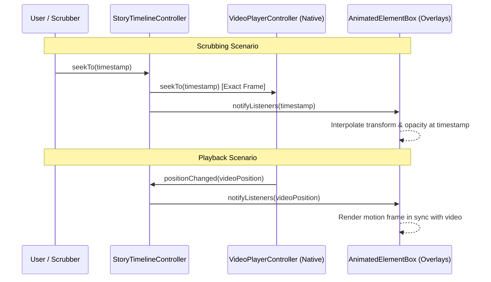

# FocusGram Story Kit — Phase 5 Architecture Decision Records (ADRs)

**Document Version:** 1.0.0  
**Status:** Approved for Implementation  
**Target Branch:** `phase-1/implementation`  

---

## Index of Architectural Decisions

- **ADR-001:** Video Layer Representation & Canvas Placement
- **ADR-002:** Unified Timeline Clock & Hardware Video Sync Coordinator
- **ADR-003:** Video Composition & Export Engine Architecture
- **ADR-004:** Time-Ranged Layer Interval & Animation Schema
- **ADR-005:** Audio Mixing, Muting & Drift Mitigation Policy
- **ADR-006:** Export Job Lifecycle, Cancellation & Storage Quota Management
- **ADR-007:** Long Video Ingestion & Truncation-Prevention Policy

---

## ADR-001: Video Layer Representation & Canvas Placement

### Context
Story creators frequently record or import full-screen background video, but also increasingly place video stickers, reaction clips, or picture-in-picture videos as composable layers alongside text, drawings, and shapes. We must establish how video media is represented within the `StoryProject` document tree.

### Decision
Support two distinct video integration patterns in `StoryProject`:
1. **Background Video:** Attached directly to `StoryPage.backgroundAsset` with `StoryMediaSourceType.file` or `network`. It scales to fill/fit the canonical 9:16 aspect ratio letterbox and provides the default page duration.
2. **In-Canvas Video Element:** Represented as a `StoryElement` with `type: StoryElementType.video` and `payload: VideoElementPayload`. It supports standard 2D spatial transformations (`x`, `y`, `width`, `height`, `rotation`), z-order stacking, opacity, and layer locking/visibility.

### Rationale
- Decouples full-screen background video from floating video stickers.
- Reuses the existing robust `StoryTransform` coordinate system (0.0 to 1.0 normalized bounds) for in-canvas video widgets.
- Backward compatible with Phase 1–4 schemas without schema version bumping.

### Consequences
- **Positive:** Full-screen background video remains lightweight and performant. In-canvas floating video layers enjoy complete parity with text, shape, and sticker manipulation.
- **Negative:** Multiple simultaneous in-canvas video players can exhaust hardware video decoders on lower-end mobile devices.
- **Mitigation:** Enforce a maximum limit of **1 active playing video layer** simultaneously during preview (inactive video layers render their cached cover frame).

---

## ADR-002: Unified Timeline Clock & Hardware Video Sync Coordinator

### Context
In Flutter, native video playback runs on an independent platform media thread (`ExoPlayer` / `AVPlayer`), while widget animations run on Flutter's vsync animation ticker. When scrubbing or previewing, drift between the native video frame and overlay motion animations creates visual artifacts.

### Decision
Implement a centralized `StoryTimelineController` that acts as the **single source of truth** for time:
- During **playback**, the active `VideoPlayerController.position` updates `StoryTimelineController.currentPosition` via a throttled callback (30–60Hz).
- During **scrubbing / pause**, `StoryTimelineController.seekTo(position)` commands the video player to seek with exact frame tolerance (`seekTo(position)`) while synchronously broadcasting the new timestamp to all animated overlay widgets.
- If no video asset is present on the page (e.g. animated static story), an internal `Ticker`-driven clock provides playback progression.



### Consequences
- **Positive:** Guarantees frame-level alignment between overlay entrance/exit animations and underlying video action.
- **Negative:** Exact-frame seeking on video with large keyframe distances (GOP) can cause slight seek latency on older devices.
- **Mitigation:** Use fast seeking during active drag scrubbing, followed by exact keyframe seek on scrub release (`onScaleEnd` / `onPanEnd`).

---

## ADR-003: Video Composition & Export Engine Architecture

### Context
Rendering an exported MP4 story file containing background video, animated text overlays, vector shapes, drawings, and mixed audio is computationally intensive. We must choose an architecture that balances rendering fidelity, export speed, bundle size, and platform stability.

### Options Considered
1. **Full FFmpeg (`ffmpeg_kit_flutter`):** Bundle full FFmpeg binaries for Android and iOS.
2. **Pure Flutter Canvas Image-Sequence Dump + Native Muxer:** Render canvas frames to PNG/RGBA byte buffers in Flutter, then pipe to platform hardware encoder (`MediaCodec` on Android, `AVAssetWriter` on iOS).
3. **Platform-Native Composition Pipeline:** Use Android `Media3 / Transformer` and iOS `AVFoundation / AVVideoComposition`.
4. **Abstract Video Export Adapter (`StoryVideoExportAdapter`):** Define a clean interface in the kit with a lightweight native hardware implementation, decoupled from proprietary or GPL-encumbered libraries.

### Decision
Adopt **Option 4 (Abstract Video Export Adapter with Native Hardware Pipeline)**:
- Define `StoryVideoExportAdapter` in `focusgram_story_kit`.
- Implement a two-pass compositing pipeline:
  1. **Visual Overlay Track:** Story Kit renders overlay layers (text, animations, drawings, shapes) at target timestamps into a transparent RGBA image stream or high-efficiency video overlay track.
  2. **Native Hardware Composition:** The platform layer utilizes native OS hardware encoders (`AVVideoCompositionCoreAnimationTool` on iOS, `Media3 Transformer / OpenGL Surface` on Android) to hardware-accelerate video scaling, trimming, overlay blending, and AAC audio muxing.
- Provide a fallback software exporter contract for environments where native hardware pipeline is mocked or disabled.

### Rationale
- **Zero GPL Licensing Risk:** Avoids `ffmpeg-kit` licensing entanglements (GPL/LGPL) which can jeopardize App Store publishing.
- **Minimal Bundle Size:** Adding FFmpeg adds 40–80MB of compiled binary bloat. Native hardware encoders add 0MB to app binary size.
- **Hardware Acceleration:** Native OS pipelines leverage on-chip hardware encoders (NVENC/VCE/Apple Silicon), reducing export times by 5–10x and preserving battery life.

---

## ADR-004: Time-Ranged Layer Interval & Animation Schema

### Context
Elements on a story canvas should not all be static. Users need stickers or text callouts to appear at specific timestamps (e.g., from 00:02 to 00:05 of a 15-second video), and enter/exit with engaging motion transitions (Fade, Scale, Slide, Bounce).

### Decision
Extend `StoryElement` with two optional schema fields:
1. `visibleTimeRange`:
   ```dart
   class LayerTimeRange {
     final Duration start;
     final Duration end;
     bool isVisibleAt(Duration timestamp);
   }
   ```
2. `animation`:
   ```dart
   class OverlayAnimationConfig {
     final OverlayAnimationType entranceType;
     final Duration entranceDuration;
     final OverlayAnimationType exitType;
     final Duration exitDuration;
     final String easingCurve; // 'linear', 'easeIn', 'easeOut', 'easeInOut', 'bounce'
   }
   ```
During canvas rendering and export, the visual state of an element at timestamp $t$ is computed via a pure mathematical function:
$$\text{State}(t) = f(\text{payload}, \text{visibleTimeRange}, \text{animation}, t)$$

### Consequences
- **Positive:** Pure functional evaluation guarantees **100% parity** between live canvas preview and exported video frames.
- **Negative:** Elements popping in and out may cause unexpected layer hit-testing clicks if the playhead moves.
- **Mitigation:** If an element is invisible at current playhead position, it is excluded from canvas hit-testing and selection.

---

## ADR-005: Audio Mixing, Muting & Drift Mitigation Policy

### Context
Stories can include original video audio, background music tracks, and voiceovers. Audio drift (loss of sync between video picture and sound) is a fatal defect in social video apps.

### Decision
Establish an explicit `VideoAudioPolicy` model:
- `muteOriginal`: Boolean flag to completely disable the source video audio track.
- `originalVolume`: Float multiplier (`0.0` to `1.0`).
- `musicAsset`: Optional `StoryMediaAsset` referencing background soundtrack.
- `musicVolume`: Float multiplier (`0.0` to `1.0`).
- `musicStartTime`: Timestamp offset into soundtrack.

**Drift Mitigation Rules:**
1. Master clock is locked to the audio track during native export. If video frames are slightly delayed, the audio track continues uninterrupted and subsequent video frames are dropped or duplicated to match audio presentation timestamps (PTS).
2. All audio resampled to uniform 44.1kHz or 48kHz stereo AAC before multiplexing.

---

## ADR-006: Export Job Lifecycle, Cancellation & Storage Quota Management

### Context
Video exports can take several seconds. Users may cancel an export, receive a phone call, background the app, or run out of disk space.

### Decision
Model all exports as asynchronous `VideoExportJob` instances:
- Each job generates a unique `jobId` (UUID) and creates an isolated temporary working directory (`<app_temp>/story_export_<jobId>/`).
- **Progress Reporting:** Emits typed `Stream<VideoExportProgress>` with phase indicators (`preparing`, `renderingOverlays`, `encodingVideo`, `muxingAudio`, `finalizing`) and normalized percentage (`0.0` to `1.0`).
- **Cancellation Guarantee:** Calling `job.cancel()` immediately aborts background isolates and native threads, deletes all temporary output files, and guarantees no partial/corrupted video is left on disk or reported as success.
- **Disk Space Pre-flight Check:** Estimate required disk space ($\text{duration} \times \text{bitrate} \times 1.5$ headroom). If storage is insufficient, fail fast with `ExportError.insufficientDiskSpace` before encoding starts.

---

## ADR-007: Long Video Ingestion & Truncation-Prevention Policy

### Context
Per `docs/STORY_KIT_IMPLEMENTATION_PLAN.md` Section 6.15:
> *"Define long video behavior as explicit full clip, selected trim/window, segments, or clear rejection. Acceptance: No video is silently truncated."*

### Decision
Implement three explicit, mutually exclusive policies for video files exceeding the configured story limit (e.g. 15s or 30s):
1. **`VideoDurationPolicy.trimWindow` (Default):** The user is presented with the trim slider to choose the specific interval to include. The preview and export enforce this selected window.
2. **`VideoDurationPolicy.segmentPages`:** The long video is automatically split across consecutive story pages (e.g. a 45-second video becomes three 15-second pages with matching continuous trim ranges).
3. **`VideoDurationPolicy.rejectWithPrompt`:** Videos exceeding the maximum allowed limit are rejected with an actionable user-facing dialog prompting them to pick a shorter clip or open the trimmer.

**Strict Prohibition:** The engine is forbidden from silently truncating a video to the first $N$ seconds without explicit user configuration or confirmation.
