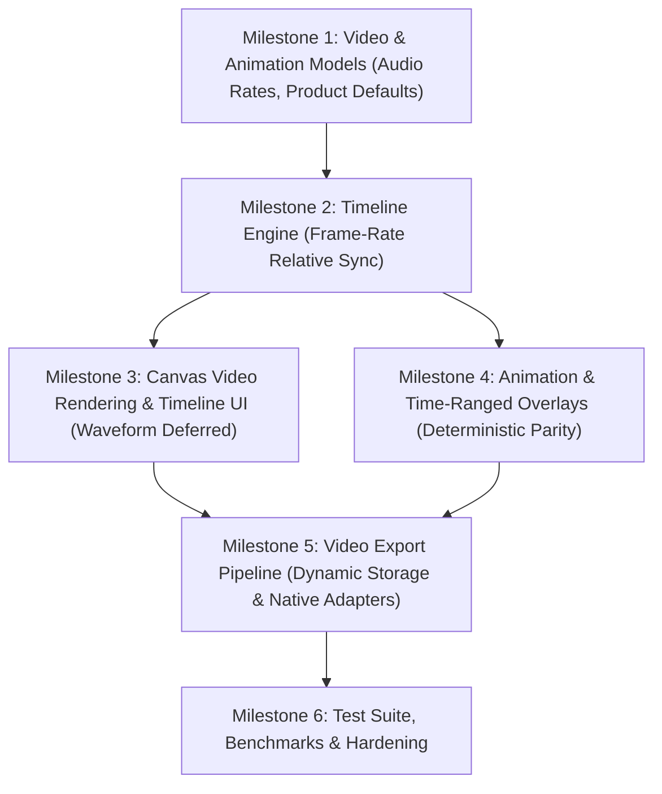

# FocusGram Story Kit — Phase 5 Execution Plan: Video and Animation

**Document Version:** 1.0.0  
**Status:** Planning / Architecture Review  
**Target Branch:** `phase-1/implementation`  
**Base Commit:** `d773edb`  
**Authoritative Plan Reference:** `docs/STORY_KIT_IMPLEMENTATION_PLAN.md` Section 5.5 & 6.15  

---

## 1. Executive Summary & Objectives

Phase 5 introduces **creator-grade video editing, time-based timeline controls, animated overlay transitions, and reliable deterministic video export** into the FocusGram Story Kit.

Building upon the solid foundation of Phase 1 (Viewer Architecture), Phase 2 (Content Integration), Phase 3 (Editor MVP), and Phase 4 (Editing Capabilities Expansion), Phase 5 transforms the editor from a still-image canvas into a complete multi-media story creation suite capable of:
1. Ingesting, trimming, and playing background and in-canvas video assets.
2. Managing a unified timeline clock across visual layers, video tracks, and interactive overlays.
3. Defining per-layer time ranges (`[startTimeMs, endTimeMs]`) and entrance/exit motion animations.
4. Providing audio policy controls (mute original audio, volume mixing, external audio provider hooks).
5. Executing background video rendering and export with typed job progress, cancellation guarantees, temporary file ownership, and hardware-accelerated platform composition.

---

## 2. Scope & Phase Boundaries

### 2.1 In Scope for Phase 5
- **Video Document Models & Product Defaults:**
  - Versioned representation of video assets, trim intervals, playback speed, aspect ratio fitting, and audio policy (`StoryVideoPayload`, `VideoTrimRange`, `VideoAudioPolicy`).
  - **Host-Configurable Maximum Story Duration:** Configurable via `StoryKitConfiguration.maxStoryDuration` (defaults to **15 seconds**, customizable up to 60 seconds by host app).
  - **Interactive Trim as Product Default:** Long videos exceeding `maxStoryDuration` trigger interactive trim mode by default.
  - **Automatic Multi-Page Segmentation (Optional):** Optional feature splitting long video across consecutive story pages.
  - **Configurable Audio Output:** Configurable audio sample rates (`AudioSampleRate.hz44100` and `AudioSampleRate.hz48000`) and stereo AAC bitrate.
- **Timeline & Clock Engine:** Unified timebase managing timeline scrubbing, playback state, and synchronization between `video_player` controllers and overlay animations (`StoryTimelineController`) with **frame-rate-relative sync tolerance** ($\pm 1000/\text{fps}\text{ ms}$).
- **Interactive Timeline Controls:** Visual timeline scrubber widget with frame filmstrip previews, trim handles (in/out points), current playhead indicator, and cover-frame selector.
- **Layer Timing & Animations:** Time-bounded layer visibility (`visibleTimeRange`), entrance/exit transitions (`Fade`, `Scale`, `Slide`, `Bounce`), and easing curves using pure deterministic mathematical functions $f(t)$ for 100% preview-export parity.
- **Video Export Architecture:** Abstracted export pipeline (`StoryVideoExportAdapter`, `StoryVideoExporter`) supporting chunked frame rendering, platform hardware muxing (Android Media3 Transformer / iOS AVFoundation custom compositor), progress streaming, cancellation, and dynamic storage estimation.
- **Deterministic Testing:** Mock video controller harness, timeline math unit tests, widget interaction tests, and simulated export validation.

### 2.2 Out of Scope (Deferred to Future Phases)
- **Audio Waveform Visualization:** Visual waveform rendering in the timeline scrubber is **explicitly deferred from the initial MVP**; the scrubber focuses on high-precision video filmstrip thumbnails and trim handles.
- **Phase 6 Content-to-Story Sharing:** Host-app feed post embedding, carousel slide selection, and note/article rich cards belong to Phase 6.
- **Multi-Track Complex NLE:** Complex non-linear editing (e.g. multi-layer simultaneous video clip cross-dissolves, speed ramping, keyframe bezier graphs) is deferred to future major releases.
- **Third-Party Commercial SDKs:** Hard proprietary vendor lock-in dependencies (e.g., Banuba, BytePlus) are excluded.

---

## 3. Milestone Breakdown

### Milestone 1: Video & Animation Models, Codecs & Serialization
- **Deliverables:**
  - `lib/models/video_payload.dart`: `StoryVideoPayload`, `VideoTrimRange`, `VideoAudioPolicy`, `AudioSampleRate` (`hz44100`, `hz48000`), `VideoFitMode`.
  - `lib/models/overlay_animation.dart`: `OverlayAnimationType`, `OverlayAnimationConfig`, `LayerTimeRange`.
  - `lib/models/story_element.dart`: Add `StoryElementType.video` and optional `animation` / `timeRange` properties.
  - `lib/models/story_page.dart`: Support video background assets with trim parameters and audio configuration.
  - `lib/models/story_kit_configuration.dart`: Host-configurable `maxStoryDuration` (defaults to 15s) and `defaultVideoDurationPolicy`.
  - Schema migration & JSON round-trip tests (`test/phase5_models_test.dart`).

### Milestone 2: Timeline Engine & Unified Clock Synchronization
- **Deliverables:**
  - `lib/timeline/timeline_controller.dart`: High-precision playhead timebase (`Duration currentPosition`, `Duration totalDuration`, `bool isPlaying`).
  - `lib/timeline/timeline_state.dart`: Immutable state tracking playhead position, loop points, and active layer IDs.
  - `lib/timeline/timeline_sync_coordinator.dart`: Bidirectional synchronization between Flutter `AnimationController` and native `VideoPlayerController` playback clocks with dynamic frame-rate-relative tolerance ($\pm 1000/\text{fps}\text{ ms}$).

### Milestone 3: Canvas Video Rendering & Timeline UI
- **Deliverables:**
  - `lib/editor/canvas/canvas_video_view.dart`: Active video layer rendering with aspect ratio preservation, transform matrix support, and pause/play overlay state.
  - `lib/editor/panels/timeline_scrubber.dart`: Responsive timeline scrubber with draggable playhead, trim handles, and timestamp readout (waveform deferred from MVP).
  - `lib/editor/panels/cover_picker_sheet.dart`: Video cover-frame selector displaying video thumbnail sequence.
  - `lib/editor/panels/audio_settings_sheet.dart`: Audio controls (mute original audio, volume slider, sample rate selector, background music toggle).

### Milestone 4: Animation & Time-Ranged Overlays
- **Deliverables:**
  - `lib/editor/canvas/animated_element_box.dart`: Wraps `CanvasElementView` with time-based opacity, scale, and offset transformations computed from `timeline_controller.currentPosition`.
  - `lib/editor/panels/animation_picker_sheet.dart`: Modal sheet for configuring entrance/exit transitions and duration for selected elements.
  - Pure mathematical transition formula $f(t)$ guaranteeing 100% parity between preview canvas and export frames.
  - Easing curves and motion interpolation adhering to reduced-motion system preferences.

### Milestone 5: Video Export Pipeline & Job Lifecycle
- **Deliverables:**
  - `lib/export/video_export_adapter.dart`: Abstract platform contract for hardware video encoding and muxing (Media3 Transformer on Android / AVFoundation custom compositor on iOS).
  - `lib/export/story_video_exporter.dart`: Orchestrates frame composition, audio mixing, and temporary file lifecycle with dynamic storage pre-flight estimation.
  - `lib/export/video_export_job.dart`: Job descriptor with UUID, `Stream<double> progress`, `Future<void> cancel()`, and `VideoExportResult`.
  - `lib/export/export_error.dart`: Typed error classification (`insufficientDiskSpace`, `unsupportedCodec`, `cancelled`, `timeout`, `corruptSource`).

### Milestone 6: Test Suite, Benchmarks & Hardening
- **Deliverables:**
  - `test/phase5_timeline_test.dart`: Timeline scrubbing, loop behavior, dynamic frame tolerance, and playhead calculations.
  - `test/phase5_animation_test.dart`: Frame-time interpolation of opacity, transform, and visibility ranges.
  - `test/phase5_export_test.dart`: Export job lifecycle, cancellation cleanup, dynamic storage estimation, and progress streaming.
  - `test/story_editor_phase5_widget_test.dart`: Widget tests for timeline scrubber, video preview, and modal sheets.
  - Full package regression verification (`flutter test`, `flutter analyze`, `dart format`).

---

## 4. File-Level Implementation Roadmap

| Path | Responsibility | New / Modified |
| :--- | :--- | :--- |
| `lib/models/video_payload.dart` | Video payload, trim bounds, audio settings, sample rates, fit modes | **NEW** |
| `lib/models/overlay_animation.dart` | Time-range visibility, animation presets, easing | **NEW** |
| `lib/models/element_payloads.dart` | Export video payload and animation definitions | **MODIFIED** |
| `lib/models/story_element.dart` | Add video type, timeRange, and animation metadata | **MODIFIED** |
| `lib/models/story_page.dart` | Background video trim range & audio policy | **MODIFIED** |
| `lib/timeline/timeline_controller.dart` | Unified timeline playback and scrubbing controller | **NEW** |
| `lib/timeline/timeline_sync_coordinator.dart`| Dynamic frame-relative sync between video and overlays | **NEW** |
| `lib/editor/editor_state.dart` | Active timeline tool, scrubber zoom, playhead position | **MODIFIED** |
| `lib/editor/editor_commands.dart` | Trim, animation, audio, and video layer commands | **MODIFIED** |
| `lib/editor/editor_controller.dart` | High-level timeline and video manipulation APIs | **MODIFIED** |
| `lib/editor/canvas/canvas_video_view.dart` | Canvas widget rendering video texture with transforms | **NEW** |
| `lib/editor/canvas/animated_element_box.dart` | Animated layer wrapper driven by timeline position | **NEW** |
| `lib/editor/canvas/story_editor_canvas.dart` | Integrated animated element box & video background | **MODIFIED** |
| `lib/editor/panels/timeline_scrubber.dart` | Draggable timeline scrubber with trim handles (waveform deferred) | **NEW** |
| `lib/editor/panels/cover_picker_sheet.dart` | Video cover-frame selector sheet | **NEW** |
| `lib/editor/panels/animation_picker_sheet.dart`| Animation transition preset selector sheet | **NEW** |
| `lib/editor/panels/audio_settings_sheet.dart` | Audio policy, sample rate & volume adjustment sheet | **NEW** |
| `lib/editor/story_kit_editor.dart` | Editor shell integration with timeline toggle | **MODIFIED** |
| `lib/export/video_export_adapter.dart` | Platform video composition and encoding interface | **NEW** |
| `lib/export/story_video_exporter.dart` | Video export orchestrator, dynamic storage check & job manager | **NEW** |
| `lib/export/video_export_job.dart` | Job token, progress stream, cancellation handle | **NEW** |
| `lib/export/export_result.dart` | Extended with `VideoExportResult` & video metadata | **MODIFIED** |
| `lib/focusgram_story_kit.dart` | Export Phase 5 models, timeline, panels, and exporter | **MODIFIED** |
| `test/phase5_models_test.dart` | Serialization and validation tests for video models | **NEW** |
| `test/phase5_timeline_test.dart` | Timeline controller math, scrubbing, and sync tests | **NEW** |
| `test/phase5_animation_test.dart` | Animation interpolation and visibility tests | **NEW** |
| `test/phase5_export_test.dart` | Export job lifecycle, cancellation, and cleanup tests | **NEW** |
| `test/story_editor_phase5_widget_test.dart` | Interactive widget tests for timeline and sheets | **NEW** |

---

## 5. Acceptance Criteria & Quality Gates

1. **Deterministic Timeline Synchronization:**
   - Playhead scrub position maps 1:1 with video frames and animated overlay transforms.
   - Synchronization tolerance strictly respects frame-rate-relative bounds ($\pm 1000/\text{fps}\text{ ms}$).
   - Pausing the timeline halts all layer animations and video playback simultaneously.
2. **Audio Integrity & Configurable Output:**
   - Mute policy explicitly silences video audio tracks without dropping video frames.
   - Volume multipliers apply predictably; no unexpected audio clipping or pops.
   - Audio output conforms to the configured sample rate (`44.1kHz` or `48kHz`) and stereo AAC encoding.
3. **Animation Fidelity & Transition Parity:**
   - Elements outside their `visibleTimeRange` are completely omitted from canvas rendering and hit-testing.
   - Animations interpolate deterministically based solely on current timestamp $t$, enabling exact frame-by-frame export repeatability.
4. **Reliable Export & Dynamic Storage Safety:**
   - Pre-flight storage validation computes peak temp storage dynamically; exports abort safely before allocation if disk space is insufficient.
   - Cancelled export jobs immediately terminate background processing and delete temporary artifacts.
   - Export failure surfaces actionable, strongly typed error diagnostics.
   - No silent video truncation: videos exceeding host-configured `maxStoryDuration` require interactive trimming or optional multi-page segmentation.
   - Elements outside their `visibleTimeRange` are completely omitted from canvas rendering and hit-testing.
   - Animations interpolate deterministically based solely on current timestamp $t$, enabling exact frame-by-frame export repeatability.
4. **Reliable Export & Resource Safety:**
   - Cancelled export jobs immediately terminate background processing and delete temporary artifacts.
   - Export failure surfaces actionable, strongly typed error diagnostics.
   - No silent video truncation: videos exceeding maximum duration are flagged or segmented per explicit configuration.
5. **Quality & Regression Standards:**
   - 100% pass rate on all existing 86 Phase 1–4 tests.
   - Zero analyzer issues under `flutter_lints` 5.0.0.
   - Format compliance verified via `dart format --output=none --set-exit-if-changed .`.
