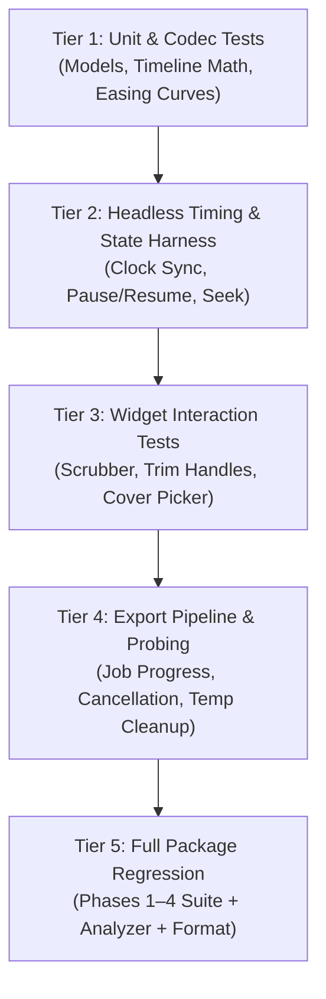

# FocusGram Story Kit — Phase 5 Verification Strategy

**Document Version:** 1.0.0  
**Status:** Verification Protocol Approved  
**Target Branch:** `phase-1/implementation`  
**Applicable Standards:** `AGENTS.md` & `docs/STORY_KIT_IMPLEMENTATION_PLAN.md` Section 8  

---

## 1. Overview & Verification Philosophy

Video editing, animation, and hardware export introduce complex asynchronous, temporal, and platform-specific failure modes that cannot be caught by basic UI tests alone.

To ensure production reliability, Phase 5 enforces a multi-tiered verification strategy:
1. **Mathematical Determinism:** Time-ranged overlay visibility and animation interpolation must be purely deterministic functions of timestamp $t$.
2. **Headless Testability via Fakes:** CI environments without hardware decoders must be able to thoroughly test playback synchronization, timeline scrubbing, and export job lifecycles via a test harness (`FakeVideoPlayerController`, `FakeVideoExportAdapter`).
3. **Rigorous Export Probing:** Rendered media must be probed for valid container signatures (`ftyp`), exact frame duration, audio presence, and artifact cleanup.
4. **Zero Regressions:** All existing 86 tests from Phases 1–4 must continue to pass unconditionally.

---

## 2. Multi-Tiered Test Matrix

### Tier 1: Unit, Model & Codec Tests (`test/phase5_models_test.dart`)
- **Video Model Round-Trip:** Serialize and deserialize `StoryVideoPayload`, `VideoTrimRange`, `VideoAudioPolicy`, `AudioSampleRate` (`hz44100`, `hz48000`), and `StoryMediaAsset`. Verify defaults and bounds.
- **Product Defaults Verification:** Validate that `StoryKitConfiguration.maxStoryDuration` defaults to 15s, `defaultVideoDurationPolicy` defaults to `VideoDurationPolicy.trimWindow`, and `AudioSampleRate` defaults to 44.1kHz.
- **Time Range Math:** Validate `LayerTimeRange.isVisibleAt(t)`. Test boundary conditions:
  - $t < \text{start}$: Hidden.
  - $\text{start} \le t \le \text{end}$: Visible.
  - $t > \text{end}$: Hidden.
  - Zero-duration ranges, inverted ranges ($\text{start} > \text{end}$ clamped gracefully).
- **Animation Interpolation Curves & Transition Parity:** Verify mathematical output of entrance/exit transitions at normalized intervals $p \in [0.0, 1.0]$:
  - `Fade`: Opacity transitions smoothly from $0.0 \to 1.0$ (entrance) and $1.0 \to 0.0$ (exit).
  - `Scale`: Scale multiplier transitions smoothly from $0.0 \to 1.0$ without negative scale inversion.
  - `Slide`: Offset transitions from off-screen bounds ($y = 1.0$) to anchor position ($y = 0.0$).
  - Assert that pure mathematical evaluation $f(t)$ yields bitwise-identical transformation states between preview logic and export frame rasterization.
- **Backward Compatibility:** Deserializing older Phase 1–4 JSON projects without video or animation fields must produce stable defaults (`visibleTimeRange: null`, `animation: null`).

### Tier 2: Timeline Engine & Synchronization Tests (`test/phase5_timeline_test.dart`)
- **Frame-Rate-Relative Synchronization:** Assert that playhead timebase coordinates with native video within dynamic frame-rate tolerance bounds:
  $$\text{Tolerance}(\text{fps}) = \pm 1 \text{ frame} = \pm \left(\frac{1000}{\text{fps}}\right) \text{ms}$$
  - At 60 fps: $\le 16.67\text{ms}$
  - At 30 fps: $\le 33.33\text{ms}$
  - At 24 fps: $\le 41.67\text{ms}$
- **Scrubbing Precision:** Seek operations must update `currentPosition` without rounding errors or jitter. Fast approximate seek during drag; exact keyframe seek on scrub release.
- **Loop Boundary Handling:** Playhead reaching `trimEnd` must loop back to `trimStart` or halt based on configured repeat policy.
- **Pause & Resume Sync:** Pausing the timeline halts the playhead; resuming continues from the exact paused timestamp without time skipping.
- **Multi-Layer Coordination:** Assert that multiple animated layers query the identical timestamp $t$ on any given frame.

### Tier 3: Widget Interaction Tests (`test/story_editor_phase5_widget_test.dart`)
- **Timeline Scrubber Rendering:**
  - Verify playhead bar, trim handles, duration label, and current time readout.
  - Audio waveform deferred from MVP: verify scrubber renders filmstrip previews without attempting unneeded audio waveform decoding.
  - Dragging playhead updates `timeline_controller.currentPosition`.
  - Dragging left/right trim handles updates `trimRange.start` and `trimRange.end`.
- **Canvas Video & Layer Visibility:**
  - Elements outside active time range are omitted from the widget tree and cannot be tapped or selected.
  - When playhead enters the layer's time interval, the element appears and becomes interactive.
- **Cover Picker Sheet:**
  - Selecting a thumbnail updates `coverTimestamp`.
- **Audio Settings Sheet:**
  - Toggling mute updates `VideoAudioPolicy.muteOriginal`.
  - Dragging volume slider updates `VideoAudioPolicy.originalVolume`.
  - Selecting sample rate updates `StoryVideoExportConfig.audioSampleRate`.

### Tier 4: Video Export Pipeline Tests (`test/phase5_export_test.dart`)
- **Dynamic Storage Estimation Pre-flight:**
  - Assert dynamic peak storage calculation:
    $$\text{PeakTempStorage} = \text{EstimatedOutputBytes} + (\text{ChunkFrames} \times W \times H \times 4) + (1.2 \times \text{EstimatedOutputBytes})$$
  - Test pre-flight failure when simulated available disk space is less than calculated peak requirement.
- **Job Creation & State Machine:**
  - Starting an export produces an active `VideoExportJob` with a unique UUID.
  - Progress stream emits monotonically non-decreasing values from `0.0` to `1.0`.
- **Cancellation & Cleanup Guarantee:**
  - Invoking `job.cancel()` transitions status to `cancelled`.
  - Temporary files created during the export are deleted immediately.
  - No partial video file is returned as a successful result.
- **Error Diagnostics:**
  - Simulated disk full, timeout, or corrupt media source throws a strongly-typed `VideoExportException` with specific `ExportErrorCode`.

### Tier 5: Media Output Probing Standards
When video export is performed against local video sources:
1. **Container & Header Probe:** Output byte array begins with valid ISO base media file format box (`ftyp` atom).
2. **Duration Verification:** Output video duration matches selected trim duration $(\text{end} - \text{start})$ within frame-rate-relative tolerance:
   $$\text{Tolerance}(\text{fps}) = \pm 1 \text{ frame} = \pm \left(\frac{1000}{\text{fps}}\right) \text{ms}$$
   (e.g., within $\pm 16.67\text{ms}$ at 60fps, $\pm 33.33\text{ms}$ at 30fps).
3. **Audio Track Probe:**
   - If `muteOriginal == true` and no music is attached, output contains no audio track or a silent audio stream.
   - If `muteOriginal == false`, output contains stereo AAC audio track matching source duration with sample rate matching configured `AudioSampleRate` (44.1kHz or 48kHz).

---

## 3. Automated Verification Gates

Every milestone and PR in Phase 5 must clear these automated gates before merge:

| Gate | Execution Command | Pass Criteria |
| :--- | :--- | :--- |
| **Code Formatting** | `dart format --output=none --set-exit-if-changed .` | 0 files changed (exit code 0) |
| **Static Analysis** | `flutter analyze` | 0 errors, 0 warnings, 0 lints (`flutter_lints` 5.0.0) |
| **Phase 5 Suite** | `flutter test test/phase5_*` | 100% tests passing |
| **Widget Suite** | `flutter test test/story_editor_phase5_widget_test.dart` | 100% tests passing |
| **Full Regression** | `flutter test` | All 86 pre-existing tests + all new Phase 5 tests pass |
| **Mobile Isolation** | `git -C Mobile status` | 7 unrelated user files remain clean and unstaged |

---

## 4. Defect & Risk Logging Protocol

If any defect, audio sync drift, or unsupported platform behavior is discovered during Phase 5 execution:
1. Log the issue immediately in `docs/PHASE_5_VERIFICATION_REPORT.md` under Section 4 ("Disclosed Limitations & Technical Risks").
2. Document whether a workaround or fallback was implemented.
3. Never weaken analyzer rules or silence test assertions merely to pass CI checks.
